# TP5 – Activité 5-1 : Service de conversion de devise avec Java RMI

**Étudiante** : Hana Ben Hmad
**Groupe** : LSI 3
**Matière** : Développement d'Applications Réparties
**Enseignante des TPs** : Zeineb DAOUD
**Année universitaire** : 2026 – 2027

## 1. Objectif
Développer une application répartie avec Java RMI permettant à un client de convertir
un montant en euros vers le dinar tunisien en invoquant une méthode sur un objet distant.

## 2. Structure du projet
```
hanabenhmad_LSI3_DevAppReparties/
├── RMIConversion_Server/
│   └── src/
│       ├── rmiService/   (IConversion, ConversionImpl)
│       └── rmiServer/    (ConversionServer)
├── RMIConversion_Client/
│   └── src/
│       └── rmiClient/    (ConversionClient)
├── captures/
├── conversionClient.jar
└── README.md
```

## 3. Travail réalisé

### 3.1 Projet serveur
Création du projet `RMIConversion_Server` avec les packages `rmiService` et `rmiServer`.

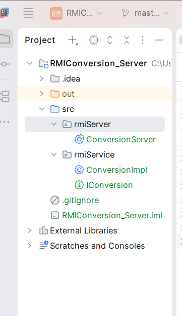

### 3.2 Interface distante `IConversion`
L'interface hérite de `Remote` et déclare la méthode
`double convertirMontant(double mt) throws RemoteException`.

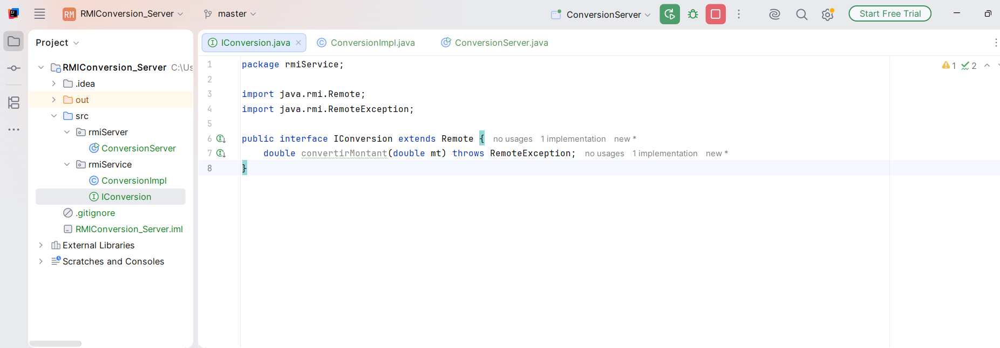

### 3.3 Implémentation `ConversionImpl`
La classe étend `UnicastRemoteObject`, implémente `IConversion` et convertit un montant en
euros en dinars avec un taux fixe de 3.35 TND pour 1 EUR.

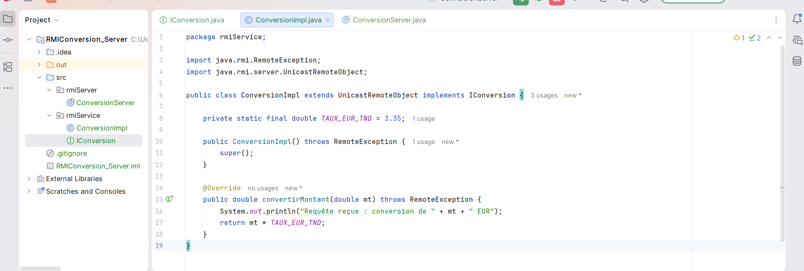

### 3.4 Serveur `ConversionServer`
Le serveur :
1. active l'annuaire RMIRegistry sur le port 1099 ;
2. crée une instance de `ConversionImpl` ;
3. publie sa référence sous le nom `ConversionService` avec `rebind`.

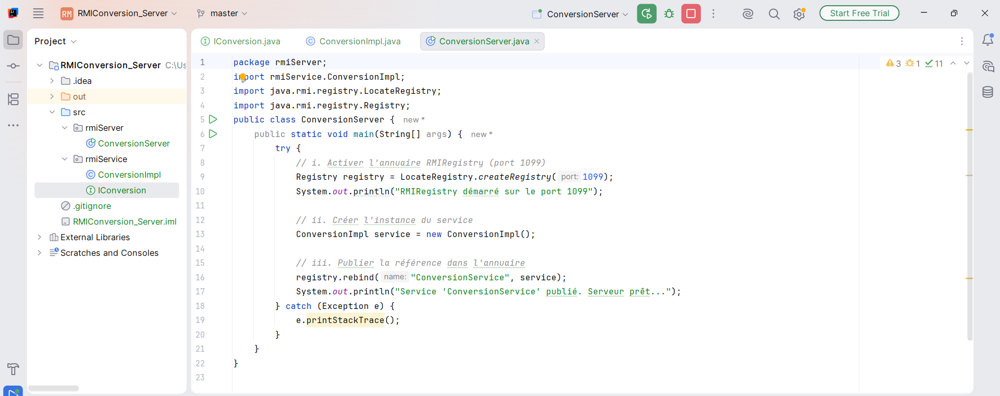

### 3.5 Export de l'interface en `.jar`
Seule l'interface `IConversion` est exportée dans `conversionClient.jar` (sans `ConversionImpl`),
avec la commande :
```
jar cvf conversionClient.jar rmiService/IConversion.class
```
Le contenu est vérifié avec `jar tf`.

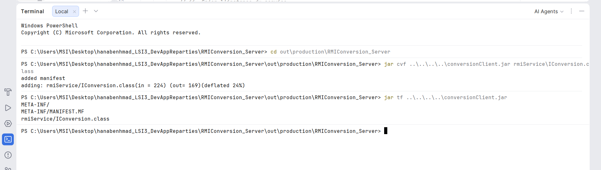

### 3.6 Projet client et classpath
Création du projet `RMIConversion_Client` et ajout de `conversionClient.jar` au classpath
(Project Structure → Modules → Dependencies).

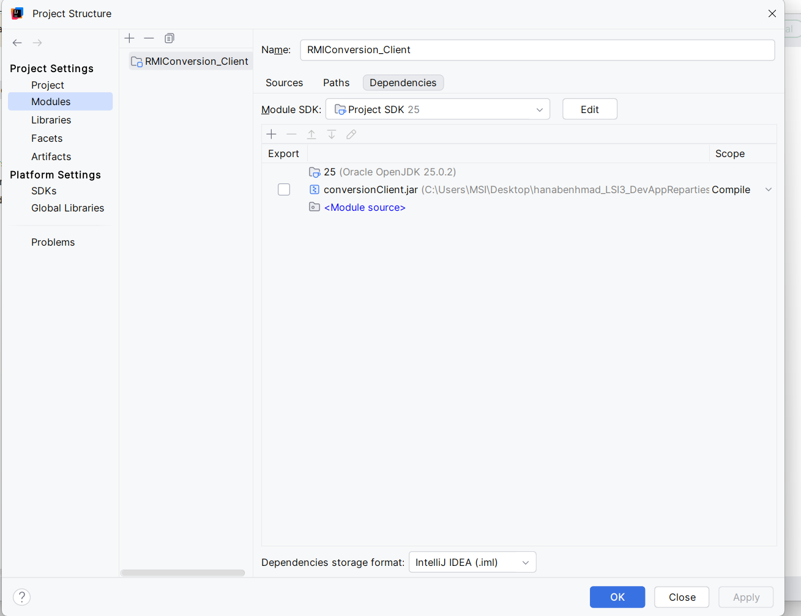

### 3.7 Client `ConversionClient`
Le client cherche l'objet distant dans le RMIRegistry (`lookup`) puis invoque
`convertirMontant(500)`.

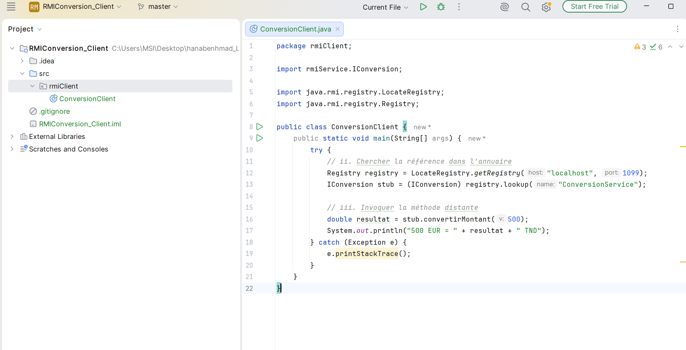

## 4. Exécution
Le serveur est lancé en premier :

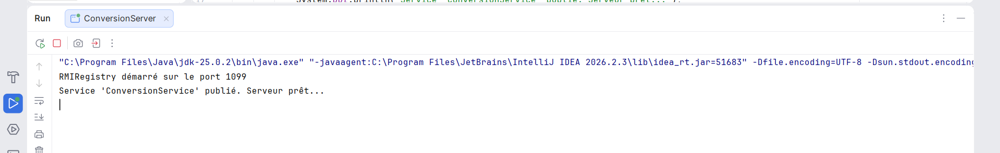

Puis le client est exécuté. Résultat : `500 EUR = 1675.0 TND`.

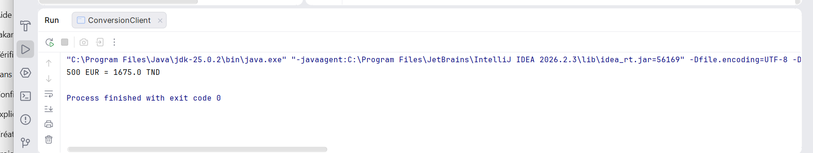

Côté serveur, la requête est bien reçue :

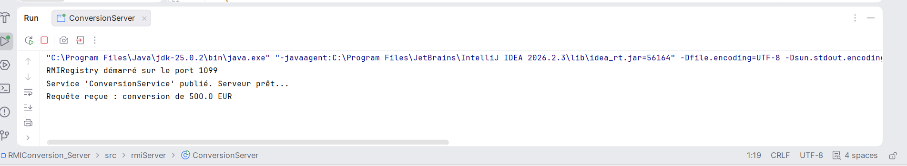

## 5. Dépôt GitHub
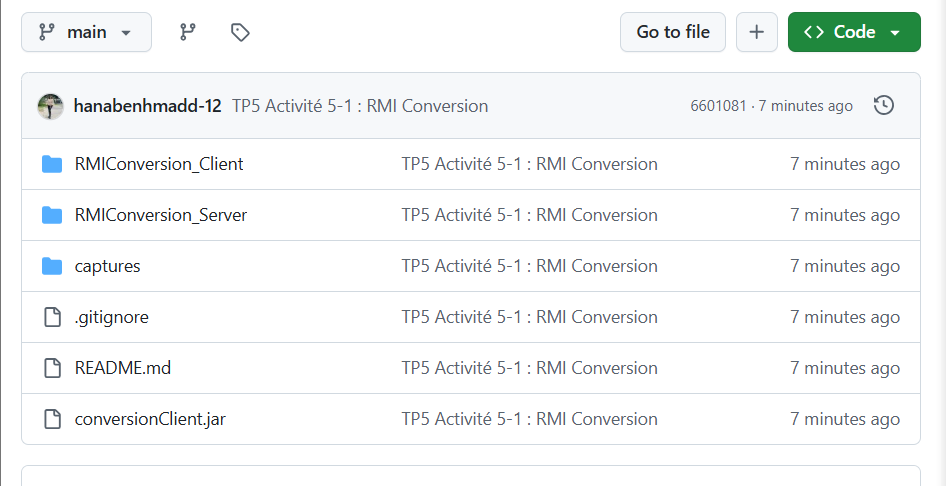

## 6. Synthèse
Ce TP m'a permis de comprendre le cycle de vie d'un service distant avec RMI :
1. **Définition de l'interface** : `IConversion` étend `Remote` et ses méthodes lèvent `RemoteException` ;
2. **Implémentation** : `ConversionImpl` étend `UnicastRemoteObject`, ce qui rend l'objet accessible à distance ;
3. **Enregistrement** : le serveur crée le RMIRegistry et publie l'objet avec `rebind` ;
4. **Invocation** : le client récupère un stub via `lookup` puis appelle la méthode comme une méthode locale.

Le client ne possède que l'interface (`conversionClient.jar`) : l'implémentation et la logique
métier restent sur le serveur. Le résultat obtenu est `500 EUR = 1675.0 TND`, ce qui confirme
le bon fonctionnement de la communication client/serveur.

## 7. Exécution du projet
1. Lancer `rmiServer.ConversionServer` (projet `RMIConversion_Server`).
2. Lancer `rmiClient.ConversionClient` (projet `RMIConversion_Client`).